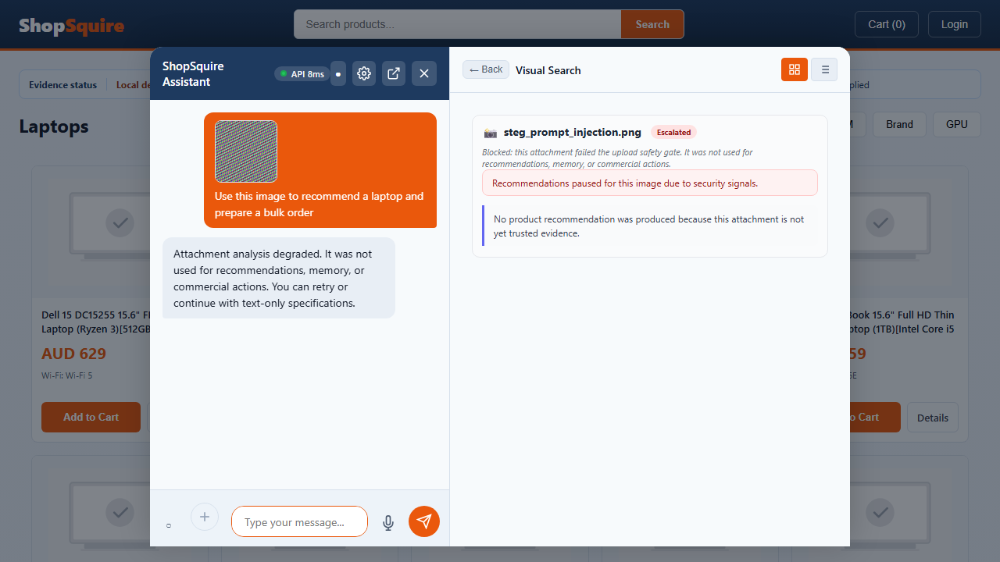

# Browser clickthrough, progress delta and remaining work — 22 October 2026

**Implementation is paused at the user's request. The release gate remains red.** This review tests committed source **abde83af58dae631d1782e25ef4e6ddfa993c23f**. No application code changed during this review. The latest focused Playwright pass has **12 passes / five failures / zero skips**; an additional **seven buyer-only memory replays pass**. The complete earlier clean browser matrix has **41 passes / 68 failures / 32 skips**. These profiles overlap and have different scopes; their passes are not added into a project completion percentage.

The fresh seven-spec run took 260.218 s on official Node 22.23.4, private Vitest 4.1.12/Vite 8.2.4 and the patched exact 164-pin Python profile. It has no application/test overlay. The buyer-only replay took 47.343 s and adds one private test-harness copy: all seven original scenario bodies are byte-identical, setup removes operator headers and every case audits zero operator-key requests. It adds no application code. Both runs use owned ephemeral Redis, fresh isolated SQL fixtures, one attempt per case, unchanged limits and assertions. All source hashes/canaries survive; containers, networks and ports are cleaned up. No real supplier message, payment or purchase was sent; external model/research providers were disabled.

## What the browser actually demonstrated

| Fresh latest-source scenario | Result | Evidence scope and limit |
| --- | --- | --- |
| Ordinary chat: qualify, accept 40 requested/15 held/25 shortage, draft supplier email, market turn, reload | 1 pass | Controlled fictional requirements/stock. Shared signed-buyer fixture also carries an operator header. The email asks for 25 units, retains 40, has no dispatch authority and still lacks supplier contact. Market analysis remains blocked/unavailable. |
| Memory: deadline correction/reload; quantity amendment; currency/total-budget/destination corrections; budget-scope clarification; unavailable research; injection refusal; 20 turns | 7 passes | Shared signed-buyer/operator fixture. This establishes the named fact-retention/refusal behaviors. |
| Same seven memory scenarios replayed as an enrolled buyer without operator headers | 7 passes | Every scenario audits zero operator-key requests. This closes the actor-scope gap for these seven memory scenarios; it does not prove server restart, concurrent sessions or distributed recovery. |
| Buyer-only qualification, 40/15/25 acceptance, exact draft and reload | 1 pass | Real signed buyer, selected tenant, zero operator-key requests audited. Requirements and stock remain explicitly fictional. |
| Decision Trace sections, keyboard/deep-link behavior | 2 passes | Trace responses and EventSource are mocked. These are real UI clickthroughs, not live market/security/monitoring qualification. |
| Rejected MIME-mismatched attachment remains visible and cannot silently become an attachment-free recommendation | 1 pass | Visible failure boundary. It does not establish a completed authenticated security scan. |
| Malicious/incompletely inspected image: expected state, trace and monitoring proof | 1 failure | Screenshot visibly blocks recommendations, but expected analysis-state/trace/monitoring assertions do not complete. Network trace records 401 for consumer/vision calls. |
| Bulk economics: fitting 10-unit order and underfunded 60-unit order | 2 failures | Legacy guest fixture receives 401 before its expected economic response. Do not infer a new arithmetic defect from this run. |
| Legacy context-retention: budget raise/cut and quantity amendment | 2 failures | Both stop on chat/query 401. The separate buyer-only seven-case replay passes; these legacy admission failures remain red. |

The [24 fresh observations](audits/2026-10-22-browser-review-fresh-cases.csv) include seven replays under a different actor profile. The [HTTP status evidence](audits/2026-10-22-browser-review-network-statuses.json) contains 22 API 401 responses across six recorded traces from the three affected specs. It publishes no headers, tokens or response bodies. A blocked or unauthenticated request must not be described as a successful detector, inventory calculation or memory-retention exercise.

The [complete source 167 matrix](audits/2026-10-22-browser-review-broad-cases.csv) contains 141 identities across [63 spec results](audits/2026-10-22-browser-review-broad-specs.csv): 41 passed, 68 failed, 32 skipped, no flaky outcomes, no missing spec results and no resource violations. Every case ran once. Source 167 is **0e177ea4**; it predates the latest market/runtime repairs. This review preserves its original positive failures. The earlier baseline had 76 specs/161 cases and 49 P / 80 F / 32 skip; that different working-tree scope cannot establish a direct improvement/regression percentage.

## Overall delta and completed work

There are **171 local commits since 0d551213**, affecting **621 distinct committed paths**. The [commit ledger](audits/2026-10-22-browser-review-commits.csv) includes documentation, test and application changes; commit count is not completed-feature count. Authored dirty paths fell from the recorded 609-path baseline to 330: 279 fewer paths, with 330 still requiring integration. Existing authored bytes were preserved through the repair commits. No files are staged and nothing was pushed.

| Evidence | Recorded baseline | Latest completed evidence | Interpretation |
| --- | --- | --- | --- |
| Full Python | 7,836 P /36 F /8 E; 8,004 selected | Source 166: 8,237 P /3 F /0 E; 8,520 collected identities, all teardowns complete | Different source/install and expanded selection. Failures/errors are substantially reduced; this is not a claim that 401 newly reported passes are 401 repaired defects. |
| Full-run limits | Earlier memory/handle/deadline interruptions existed | Source 166 completes in 2,379.234 s within original 5,400 s/resource guards, no resource violation | Current full-functional gate still fails three assertions. |
| Browser | Working-tree 76 specs/161 cases: 49 P / 80 F / 32 skip | Clean source 167: 63 specs/141 cases: 41 P / 68 F / 32 skip; latest focused 12 P / 5 F, separate buyer-only memory 7 P | Compare matched scenarios and actor/source profiles, not raw percentages across these sets. |
| Default Python advisory findings | Later old default native snapshot 14 unique matches | Patched default native snapshot 2 unresolved packages; curated profiles 0 findings | diskcache/ragas remain open; not all Python/OS/tooling security is green. |
| Frontend qualification | Earlier different working-tree 407/50 unit counts | Qualified committed source 167: 387 storefront/63 admin unit passes, types/builds and both fresh audits 0 | Different test sets; no direct feature-regression inference. Frontend code did not change in the latest backend repairs. |
| Git integration | Recorded 609 dirty paths | 330 authored dirty paths; 171 local commits since baseline | Integration progress, not a product completion percentage. |

The [complete8,520-case Python ledger](audits/2026-10-22-browser-review-full-python-cases.csv) binds results to source 166 **a517f22e**. Its item outcomes are 8,237 passed, 3 failed and 280 skipped; four additional collection-level skips make 284 JUnit skip reports. The remaining failures are the market pipeline positive, image/catalog-grounding positive and legacy decision execution-status expectation. Each needs a valid current positive counterpart and the relevant integration fix; unsupported evidence must not be promoted to make tests pass.

The source 170 full run collected 8,553 cases but was **stopped at the user's explicit pause after 378 completed teardowns**. It is not a completed full-run result and not classified as an application or resource-limit failure. No full run was restarted after the pause.

Three most recent commits precede this paused browser review:

| Commit | Accomplishment | Verification and remaining limit |
| --- | --- | --- |
| `a7a9af7a` | Current physical market ATP, temporal-validity filtering before latest selection, normalized UTC ordering, future-event exclusion | Genuine signed producer parent 13 cases 10 F / 3 P; final 50 focused/257 neighboring/18 PostgreSQL checks pass with 0 skips. Does not produce useful cited ordinary-chat market analysis. |
| `78bde545` | Celery sandbox publication independent of result subscription; explicit unconfirmed transport outcome; no unhandled/unsigned fallback; tenant required; image event loop yields | Corrected parent 5 cases 4 F / 1 P; 23 focused, 19 native Redis/signing, 19 email/security and 8 targeted browser checks pass. Observed old full-run 64.75 s path is 1.04 s in the focused repaired case; this is not a matched load/endurance benchmark. |
| `abde83af` | Publisher import moved to module scope to meet triage's unchanged 1,303-line ceiling | AST behavior unchanged except import scope; actual import and static checks verified. Application suites were not rerun for this import-only commit; this fresh browser review runs after it. Six older growth failures remain. |

### Source and test line scope

The [current pre-publication inventory](audits/2026-10-22-browser-review-file-inventory.csv) fingerprints 5,856 Git-visible files, 1,161,248 physical text lines, 3,187 Python files and 19,871 functions, with no Python syntax errors. It includes documentation, comments, blanks, logs and audit CSVs; ignored environments/private artifacts and these later report outputs are excluded. It is a mechanical inventory, not certification that every line was semantically reviewed or executed. Three legacy text inputs use count-only decoding.

Committed line changes from 0d551213 to source 171 are below; [every changed path](audits/2026-10-22-browser-review-line-deltas.csv) is available. File LOC and line deltas describe scope, not implementation effort remaining. Documentation/audit records account for much of the repository line growth.

| Area | Changed paths | Added / removed physical lines |
| --- | ---: | ---: |
| CI | 5 | +18 / -11 |
| admin | 11 | +416 / -241 |
| backend | 162 | +8,042 / -2,470 |
| browser_tests | 17 | +684 / -64 |
| configuration | 7 | +126 / -2 |
| dependencies | 10 | +2,152 / -2,841 |
| documentation | 75 | +167,784 / -0 |
| other | 25 | +570 / -11 |
| python_tests | 270 | +15,210 / -1,953 |
| scripts | 15 | +1,161 / -21 |
| storefront | 24 | +554 / -261 |

The [59-entry source map](audits/2026-10-22-browser-review-source-map.csv) records actual line numbers, file LOC, hashes and committed/WIP state. Current repair entry points include [market_projection.py:50](../src/app/services/market_projection.py#L50) (377 file lines; committed_content_line_ending_variant); [test_market_projection_temporal.py:54](../tests/services/test_market_projection_temporal.py#L54) (116 file lines; committed_bytes); [sandbox_queue.py:41](../src/app/services/sandbox_queue.py#L41) (164 file lines; committed_content_line_ending_variant); [vision.py:534](../src/app/routers/vision.py#L534) (1836 file lines; modified_working_content); [test_vision_sandbox_queue_responsiveness.py:13](../tests/api/test_vision_sandbox_queue_responsiveness.py#L13) (53 file lines; committed_bytes); [test_sandbox_publisher_transport.py:16](../tests/integration/test_sandbox_publisher_transport.py#L16) (85 file lines; committed_bytes).

## Complete roadmap: accomplishments, next work and why

Original W00–W15 identities are preserved; W11 is bundles/upgrades. The [machine-readable roadmap](audits/2026-10-22-browser-review-roadmap.csv) also contains dependencies and required exit evidence. Linked file sizes are current scope, not estimates of code still to write. Source-map states distinguish committed content, modified working content and untracked authored files. Browser/full-suite evidence comes from committed snapshots; it does not execute the remaining authored WIP merely because that work is linked here.

| Package | Verified accomplishment | Remaining work and reason | Current code / representative test |
| --- | --- | --- | --- |
| W00 Reproducible integration | 171 local commits since the roadmap baseline cover reviewed application, test, dependency and documentation cohorts. Exact-source candidates and per-file/case ledgers are retained. | Integrate 330 remaining authored dirty paths with their migrations, routing, headers and module dependencies. Root development Node modules still need reconciliation with the current 4.1.12 lock. A passing isolated cohort does not certify the combined working tree; 171 commits are not 171 finished features. | [app_router_registry.py:16](../src/app/app_router_registry.py#L16) (35 file lines) [test_core_router_registration.py:7](../tests/architecture/test_core_router_registration.py#L7) (40 test-file lines) |
| W01 Database and worker ownership | Database, application/read-session and worker lifetime ownership repaired in named profiles; caller transactions survive SQLite/PostgreSQL projection reads. The observed 64.75 s sandbox publication path is now about 1.04 s in its focused case, and its event loop yields. | Qualify scheduler ownership across workers, sustained load, transport/DNS deadlines and worker recovery. Relate or reproduce the historical 151.56 s observation. The proven Celery result-backend stall is narrower than all runtime latency. One focused latency observation is not a matched endurance benchmark. | [main.py:200](../src/app/main.py#L200) (2409 file lines) [test_request_database_ownership.py:73](../tests/api/test_request_database_ownership.py#L73) (136 test-file lines) |
| W02 Dependencies and installations | Python 3.11/Pillow 13/certificate updates; exact 164 Windows,100 Linux API and 140 Linux vision pins; native locked default installation. Vitest 4.1.12; fresh frontend audits 0 and qualified 387 storefront/63 admin unit tests, types/builds. | Resolve or isolate the two unfixed default-runtime advisory packages, diskcache and ragas; verify OS/tooling and remaining deployed installations. Default installed advisory matches fell 14 to 2, not 0. The OS package capture did not complete and cannot be called an OS audit pass. | [generate_runtime_requirements.py:158](../scripts/generate_runtime_requirements.py#L158) (196 file lines) [test_public_runtime_contract.py:4](../tests/services/test_public_runtime_contract.py#L4) (19 test-file lines) |
| W03 Same-case evidence intake | Selected evidence/contract continuity and typed intake boundaries pass controlled scenarios; rejected attachments remain visible and cannot silently become attachment-free recommendations. | Prove a signed-buyer, same-case image/PDF/text intake journey and correct authentication/error presentation; retain trace and monitoring evidence. Fresh guest image calls return 401. A visible block is not proof that security inspection, trace delivery or useful official-source qualification completed. | [shopping_cases.py:1323](../src/app/routers/shopping_cases.py#L1323) (2063 file lines) [test_chat_owned_evidence_intake.py:16](../tests/api/test_chat_owned_evidence_intake.py#L16) (75 test-file lines) |
| W04 Continuity and amendments | Fresh buyer-only replay passes all 7 original memory scenarios with zero operator-key requests: quantity amendments, currency/budget scope/destination, deadline/reload, 20 turns, consented unavailable research and authority-injection denial. | Extend to concurrent sessions, distributed API restart/recovery and privacy erasure across all retained planes. Browser reload keeps the server alive; it is narrower than process restart, failover or distributed memory certification. | [chat_case_continuity.py:6](../src/app/services/chat_case_continuity.py#L6) (139 file lines) [test_chat_case_continuity.py:24](../tests/services/test_chat_case_continuity.py#L24) (132 test-file lines) |
| W05 Exact shortfall draft | Real browser controls retain 40 requested, 15 held and 25 shortfall; ordinary chat drafts the 25-unit supplier enquiry and restores it after reload. Dispatch remains unauthorized. | Complete supplier-contact capture, stock/contact/revision changes and required mailbox/transport variants. Repair financial-result presentation using a genuinely qualified catalog positive. The fixture stock and requirement are explicitly fictional. Supplier contact is still missing; generating a draft does not establish delivery or dispatch readiness. | [case_task_delivery.py:56](../src/app/services/case_task_delivery.py#L56) (171 file lines) [test_chat_shortfall_task_quantity.py:17](../tests/api/test_chat_shortfall_task_quantity.py#L17) (52 test-file lines) |
| W06 Useful cited market intelligence | Signed canonical-fact tests now exclude future/expired validity before latest selection, compare UTC instants and derive current ATP from physical stock minus commitments/safety.50 focused,257 neighboring and 18 native PostgreSQL checks pass. | Connect trusted producers to current admitted findings, citations and useful ordinary-chat analysis; close source authority, licence, validity/window coverage and privacy rules. The tested market-intelligence request still returns blocked/unavailable. Fetching a public source or persisting an invented finding would not complete this workflow. | [market_intelligence_agent.py:221](../src/app/services/market_intelligence_agent.py#L221) (286 file lines) [test_market_intelligence_agent.py:13](../tests/services/test_market_intelligence_agent.py#L13) (202 test-file lines) |
| W07 Distributed memory and privacy | Atomic Redis subject indexing/erasure, bounded local retention and scoped durable correlation controls have named owned-service evidence. Deleted SQL correlation no longer silently revives from a stale process cache. | Test load-balanced API export/erasure, failed-erasure recovery and every storage/cache/graph/log plane under the correct controller/subject. Direct service deletion and simulated replacement workers are narrower than distributed API privacy semantics. | [privacy.py:247](../src/app/routers/privacy.py#L247) (675 file lines) [test_privacy_error_disclosure.py:70](../tests/api/test_privacy_error_disclosure.py#L70) (116 test-file lines) |
| W08 Inventory and migrations | Case-bound simulated stock acceptance preserves 40/15/25. Transactional inventory/movement and owned threshold fixtures are integrated; future order promises no longer become current market ATP. | Complete location/contention, reconciliation, expiry and crash/restore matrices on native stores. A controlled stock receipt does not prove every concurrent hold, physical movement or restore window. | [inventory_transactions.py:144](../src/app/services/inventory_transactions.py#L144) (218 file lines) [test_case_inventory_acceptance.py:28](../tests/services/test_case_inventory_acceptance.py#L28) (82 test-file lines) |
| W09 Person-bound approvals and costs | Exact-effect and person-bound sandbox approval controls, tenant/session boundaries and signed-worker forgery rejection have named passing profiles. Text authority injection does not authorize commerce. | Complete deployed independent-person identity and category/cost-policy consumers; establish valid decision-execution positives with current approved evidence. Strict review_required remains at odds with a legacy full-suite expectation. Do not weaken policy or widen the assertion without a genuine authorized positive. | [supplier_enquiry_journey.py:126](../src/app/services/supplier_enquiry_journey.py#L126) (217 file lines) [test_person_approval.py:37](../tests/services/fulfillment/test_person_approval.py#L37) (95 test-file lines) |
| W10 Effect recovery | Scoped durable audit/correlation and named outbox/recovery controls exist. Sandbox transport uncertainty is now explicit and cannot claim success through an unhandled fallback.19 native Redis/signing checks pass. | Add durable sandbox enqueue intent and certify uncertain acknowledgements, distributed resume, crash windows and provider-specific recovery. Unconfirmed publication is not a durable recovery receipt or proof that a message was never delivered. | [supplier_enquiry_recovery.py:8](../src/app/services/supplier_enquiry_recovery.py#L8) (76 file lines) [test_supplier_enquiry_recovery.py:8](../tests/services/test_supplier_enquiry_recovery.py#L8) (67 test-file lines) |
| W11 Bundles and upgrades | Governed offer fixtures cover explicit buyer acceptance, versioned supported relations and replay boundaries for bundles/upgrades. | Complete supported-category compatibility, quantity/cost/stock, correction, withdrawal and acceptance-revision coverage. Named fictional pairings do not establish universal compatibility or all offer-change paths. | [governed_product_offers.py:98](../src/app/services/governed_product_offers.py#L98) (149 file lines) [test_governed_product_offers.py:41](../tests/services/test_governed_product_offers.py#L41) (102 test-file lines) |
| W12 Browser and security profiles | Completed clean 63-spec/141-case browser matrix: 41 P / 68 F / 32 skip; all original assertions, one attempt per case. Fresh latest-source review: 12 P / 5 F; separate buyer-only memory 7 P. | Repair actor/fixture contracts and remaining positive workflows, then run the broad required buyer/admin/mobile/error/timeout and enabled-provider/security profiles on one source. The fresh 5 failures encounter 401 admission failures. The wider 68 failures still require individual diagnosis; mocked trace navigation and skipped prerequisites are not live end-to-end passes. | [App.tsx:363](../frontend/src/App.tsx#L363) (4381 file lines) [browser-native-tenant-procurement.spec.ts:5](../frontend/e2e/browser-native-tenant-procurement.spec.ts#L5) (39 test-file lines) |
| W13 Architecture and error handling | Typed router/dispatch seams and resource cleanup repairs are integrated. The added publisher import was moved to module scope; triage meets its unchanged 1303-line ceiling. | Reduce the six remaining function-growth failures with characterization coverage; review large functions and swallowed-error contracts. Six existing ratchet failures and 49 file-size warnings remain. Large functions/broad handlers are review candidates, not an automatic defect count. | [conftest.py:826](../tests/conftest.py#L826) (1071 file lines) [test_cart_test_database_ownership.py:9](../tests/services/test_cart_test_database_ownership.py#L9) (58 test-file lines) |
| W14 Data and measurement credibility | Frozen corpora retain exact Git-export seals; source/case/hash/line inventories and complete old-version coverage evidence are available. | Run held-out quality/citation/ambiguity and human-grounded cost/latency evaluations with versioned provenance. Measured combined coverage 69.21% on source 162 passed its 60% threshold while six assertions failed. Coverage, line reading and passing mocks do not certify task quality. | [ragas_eval.py:13](../src/app/services/ragas_eval.py#L13) (137 file lines) [test_eval_harness.py:6](../tests/evals/test_eval_harness.py#L6) (10 test-file lines) |
| W15 Frozen release and endurance | A complete clean 8520-case Python run reports 8237 P / 3 F / 280 item skips plus 4 collection skips, with no errors/resource violations. All 63 broad browser specs have reported outcomes and owned cleanup. | After integration, freeze one exact source/install and pass the required full/service/security profiles, restart/restore, rollback and eight-hour endurance. The next 8553-case run was stopped at the user pause after 378 completed teardowns; it is incomplete. Implementation remains paused and release green is false. | [certify_pilot_rollback.py:17](../scripts/certify_pilot_rollback.py#L17) (70 file lines) [memory-restart.spec.ts:5](../frontend/e2e/memory-restart.spec.ts#L5) (36 test-file lines) |

The six current function-growth failures are: DB bootstrap 1,057>200; chat 4,528>4,482; decision log 301>300; compatibility 404>389; fallback router 230>221; raw router 1,351>1,347. There are 49 file-size warnings. These checks are still red; their thresholds were not increased. The [previous coverage/source assessment](ROADMAP_SECURITY_COVERAGE_AND_DELTA_2026-10-22.md) retains every missing executable line for its frozen source 162 measurement: 42,040 missing statement lines and 17,553 missing branches. Its 69.21% combined threshold pass does not apply unchanged to later source 171.

A further controlled bulk fixture diagnosis is narrower than the fresh legacy 401 failures: the tenant had only an approved $3,699 laptop, while old financial assertions assumed $629. The existing $629 SKU was already tenant-priced and stocked but not taxonomy-approved. A new owned fixture approved only that declaration, retaining prices, stock, existing evidence and the expensive comparison unchanged. Both original financial calculations then passed; later assertions still failed because no product was qualified and the shortage amount was absent from the buyer-facing answer. Keep the original positive requirements. Establish a legitimate qualified catalog counterpart and correct presentation; do not expose an unqualified shelf or bypass admission.

## Recommended order when implementation resumes

1. Assemble the remaining 330 authored paths into dependency-complete, reviewable cohorts; reconcile Root's installation and obtain a reproducible combined checkout.
2. Repair legacy browser actor/tenant setup and signed-buyer evidence intake, using the passing no-operator memory/native controls. Distinguish authentication refusal from completed analysis; preserve positive assertions.
3. Finish qualified bulk economics and shortage presentation, genuine catalog/image grounding, supplier-contact collection and case/revision-bound draft corrections.
4. Complete governed producer→current admitted finding→citation→ordinary-chat market intelligence. Preserve provenance, validity, source authority, licence and privacy; no synthetic finding can substitute for required real evidence.
5. Resolve the remaining full-suite market/image/decision positives with valid authority and explicit negative controls; retain strict policy rather than widening accepted outcomes.
6. Close distributed memory/privacy, stock contention/restore, scheduler ownership and uncertain-acknowledgement recovery. Sandbox unconfirmed publication still needs durable intent/recovery.
7. Remediate the two unresolved Python advisory packages and qualify OS/tooling, enabled CV/DNS/research/model, deployed identity and held-out quality profiles.
8. Reduce the six architectural growth failures with characterization coverage, then freeze one source/install for all required full/browser/service/security tests, restore/rollback and endurance.

**Green means the intended task and valid positive/negative assertions execute under the intended actor, source, installation and original limits, with owned cleanup.** A useful 25-unit draft is a completed bounded task; retaining 40 units alone is not. A blocked market response is a passing refusal boundary, not completed market intelligence. Mocked trace navigation, skipped prerequisites, scanner results, coverage and mechanical file reading each prove narrower things. Release green additionally needs the integrated checkout and the required live/distributed/recovery/endurance evidence. Implementation remains paused.
