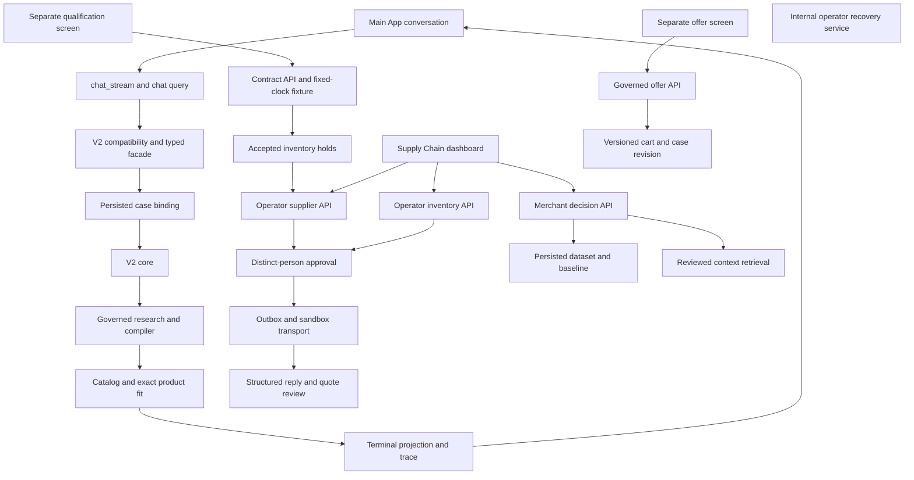

# File, line and wiring assessment — 4 October 2026

This is a critical-boundary review plus a complete structural inventory of the selected source, test, script, configuration and workflow roots. It is **not a claim that every line or every endpoint has been manually audited**. Physical line counts include comments and blank lines; neither LOC nor import counts measure quality, behavior or test coverage.

The inventory indexes 3,586 files / 681,453 physical lines; 20,187 Python definitions and 19,964 syntactic import edges. All inventoried Python files parse. Dynamic imports, dependency injection and frontend calls mean an import graph is not a runtime call graph. The live OpenAPI snapshot contains 813 method/path operations, not 813 tested workflows.

Artifacts: [all files](../.artifacts/reassessment-2026-10-04/file-inventory.csv), [Python symbol lines](../.artifacts/reassessment-2026-10-04/python-symbols.csv), [import edges](../.artifacts/reassessment-2026-10-04/python-imports.csv), [live API operations](../.artifacts/reassessment-2026-10-04/live-openapi-routes.csv). Unreviewed files are explicitly marked `indexed_not_manually_reviewed`; reviewed entries mean only the boundary described below.

## Main wiring

The disconnected recovery box is intentional: no application caller or matching operator route for that service was found. Other accounting/inventory/account-recovery routes exist; they are not the same function. The market API runs baseline and supporting retrieval separately; the UI says retrieved notes do not change the baseline. Main chat, qualification and bundle fixtures share components/services but remain different entry paths.

## Reviewed boundaries by original roadmap item

| Item | File / anchor | File LOC | Assessment and connection |
|---|---|---:|---|
| 0 | [src/app/main.py](C:/AI/ShopSquire/src/app/main.py:2353) | 2469 | Registers buyer case and operation routes; main process can be live while storefront readiness fails. |
| 0 | [src/app/app_router_registry.py](C:/AI/ShopSquire/src/app/app_router_registry.py:16) | 35 | Rejects duplicate registration names; inspect resulting runtime operations separately. |
| 0 | [src/app/bootstrap/conversation_router_group.py](C:/AI/ShopSquire/src/app/bootstrap/conversation_router_group.py:29) | 47 | Registers required chat/stream routes and records optional failures. |
| 0 | [src/app/bootstrap/business_background_lifecycle.py](C:/AI/ShopSquire/src/app/bootstrap/business_background_lifecycle.py:80) | 89 | Explicit lifespan bridge starts registered workers; expiry is opt-in. |
| 0 | [scripts/start_isolated_roadmap_backend.ps1](C:/AI/ShopSquire/scripts/start_isolated_roadmap_backend.ps1:21) | 47 | Bounded sandbox startup disables external research; startup alone is not a successful research demo. |
| 0 | [scripts/checkpoint_roadmap_source.py](C:/AI/ShopSquire/scripts/checkpoint_roadmap_source.py:6) | 46 | Checkpoint tooling exists; prior restore reused installed dependencies. |
| 0 | [scripts/seed_product_offer_demo.py](C:/AI/ShopSquire/scripts/seed_product_offer_demo.py:27) | 47 | Prices and fictional relations are timestamped when seeded; replay after a day needs explicit fresh fixture setup. |
| 1 | [frontend/src/App.tsx](C:/AI/ShopSquire/frontend/src/App.tsx:3558) | 4357 | Undefined setter remains; typecheck fails. Main buyer surface is distinct from the fixture surfaces. |
| 1 | [src/app/routers/chat.py](C:/AI/ShopSquire/src/app/routers/chat.py:871) | 4841 | Restores scoped persisted case before V2 execution; current memory browser checks pass. |
| 1 | [src/app/routers/chat_stream.py](C:/AI/ShopSquire/src/app/routers/chat_stream.py:25) | 203 | Streaming transport reaches the chat handler; test cancellation and terminal parity rather than visible text alone. |
| 1 | [src/app/services/chat_case_continuity.py](C:/AI/ShopSquire/src/app/services/chat_case_continuity.py:5) | 84 | SQL binds tenant/uid/session/subject; ambiguous latest case is rejected. |
| 1 | [src/app/services/chat_case_continuity.py](C:/AI/ShopSquire/src/app/services/chat_case_continuity.py:26) | 84 | Projection checks matching case/revision and validates budget, destinations and temporal schema. |
| 1 | [src/app/services/chat_terminal_projection.py](C:/AI/ShopSquire/src/app/services/chat_terminal_projection.py:5) | 193 | Shared terminal projection; preserve source of truth across response, shelf and trace. |
| 1 | [frontend/e2e/platform-audit-memory.spec.ts](C:/AI/ShopSquire/frontend/e2e/platform-audit-memory.spec.ts:4) | 121 | Fresh six-case browser coverage includes corrections, recall, ambiguity, direct injection and research unavailability. |
| 2 | [src/app/services/merchant_decision_dataset.py](C:/AI/ShopSquire/src/app/services/merchant_decision_dataset.py:26) | 143 | Produces immutable scoped observed history; drops incoming order ETAs into one aggregate quantity. |
| 2 | [src/app/services/inventory_event_projection.py](C:/AI/ShopSquire/src/app/services/inventory_event_projection.py:197) | 440 | Canonical event projection provides reconciliation; not interchangeable with mutable live inventory balances. |
| 2 | [src/app/services/shop_operational_history.py](C:/AI/ShopSquire/src/app/services/shop_operational_history.py:14) | 182 | Existing history/reconciliation path should be connected rather than replaced with another catalogue. |
| 2 | [src/app/services/synthetic_canonical_replay.py](C:/AI/ShopSquire/src/app/services/synthetic_canonical_replay.py:59) | 528 | Synthetic source of the pilot; latent demand stays evaluator-only; positive fixture excludes lifecycle fault probes. |
| 2 | [alembic/versions/20260887_merchant_decision_dataset.py](C:/AI/ShopSquire/alembic/versions/20260887_merchant_decision_dataset.py:11) | 24 | Persists dataset snapshots; migration presence is not ongoing ingestion or scheduling. |
| 3 | [src/app/routers/merchant_intelligence.py](C:/AI/ShopSquire/src/app/routers/merchant_intelligence.py:22) | 159 | Computes baseline from snapshot/quote, then independently retrieves supporting context; retrieval does not alter the decision. |
| 3 | [src/app/services/merchant_decision_dataset.py](C:/AI/ShopSquire/src/app/services/merchant_decision_dataset.py:64) | 143 | Scopes and expires evidence, checks reconciliation/coverage; all outstanding incoming units reduce the target irrespective of ETA. |
| 3 | [src/app/services/merchant_evidence_retrieval.py](C:/AI/ShopSquire/src/app/services/merchant_evidence_retrieval.py:28) | 132 | Bounded numeric proposals require exact source spans; semantic correctness still relies on review. |
| 3 | [src/app/services/merchant_evidence_retrieval.py](C:/AI/ShopSquire/src/app/services/merchant_evidence_retrieval.py:97) | 132 | Admission precedes lexical/dense RRF; no new graph required. Empty evidence must not be described as a successful semantic search. |
| 3 | [frontend/src/components/MerchantDecisionCard.tsx](C:/AI/ShopSquire/frontend/src/components/MerchantDecisionCard.tsx:48) | 58 | UI explicitly discloses notes do not change baseline; add truthful not-called/empty/degraded retrieval wording. |
| 3 | [src/app/services/market_pipeline.py](C:/AI/ShopSquire/src/app/services/market_pipeline.py:20) | 113 | Existing alternative ingestion/analysis path; outer error returns zero counts without explicit failed status. |
| 3 | [src/app/services/market_evidence_admission.py](C:/AI/ShopSquire/src/app/services/market_evidence_admission.py:13) | 27 | Consumption-time provenance and validity gate; scope must remain enforced by caller. |
| 3 | [src/app/services/public_market_source_fetch.py](C:/AI/ShopSquire/src/app/services/public_market_source_fetch.py:40) | 906 | Existing governed transport/parser boundary; public source fetching has not been exercised live in this audit. |
| 4 | [src/app/services/heldout_inventory_benchmark.py](C:/AI/ShopSquire/src/app/services/heldout_inventory_benchmark.py:17) | 93 | Mean/EWMA/synthetic signal comparison; fixed cutoff and evaluator-only demand, no foundation-model winner. |
| 4 | [scripts/run_heldout_inventory_benchmark.py](C:/AI/ShopSquire/scripts/run_heldout_inventory_benchmark.py:11) | 40 | Frozen manifests and output receipts; add rolling origins and misleading-signal regimes before selecting a model. |
| 4 | [src/app/services/forecast_intelligence.py](C:/AI/ShopSquire/src/app/services/forecast_intelligence.py:26) | 404 | Existing forecast comparison hooks; test missing-day/censoring interpretation before reusing daily series. |
| 5 | [frontend/src/main.tsx](C:/AI/ShopSquire/frontend/src/main.tsx:21) | 54 | Separate qualified-shop/product-offers routes bypass the ordinary App conversation; shared services do not prove a unified journey. |
| 5 | [src/app/routers/shopping_cases.py](C:/AI/ShopSquire/src/app/routers/shopping_cases.py:51) | 2067 | Main case API includes contract endpoints without a router-level identity dependency. |
| 5 | [src/app/routers/shopping_case_contracts.py](C:/AI/ShopSquire/src/app/routers/shopping_case_contracts.py:53) | 78 | Uses supplied uid/tenant and revision; direct credentialless synthetic-case selection reproduced. |
| 5 | [src/app/services/case_contract_binding.py](C:/AI/ShopSquire/src/app/services/case_contract_binding.py:25) | 135 | UID equality is an ownership comparison, not verification of the caller identity. |
| 5 | [src/app/services/recommendation_core/case_binding.py](C:/AI/ShopSquire/src/app/services/recommendation_core/case_binding.py:64) | 177 | Existing top-level V2 binding checks before and after execution; retain rather than rebuild. |
| 5 | [src/app/services/recommendation_core/case_binding.py](C:/AI/ShopSquire/src/app/services/recommendation_core/case_binding.py:135) | 177 | Passes persisted current contract/context into compilation. |
| 5 | [src/app/services/recommendation_core/requirement_compiler.py](C:/AI/ShopSquire/src/app/services/recommendation_core/requirement_compiler.py:44) | 223 | Checks scope, authority, lineage and contract coverage; derived claims require explicit policy. |
| 5 | [src/app/services/recommendation_core/contract_compilation_gate.py](C:/AI/ShopSquire/src/app/services/recommendation_core/contract_compilation_gate.py:14) | 35 | Case-selected contract restricts candidate claims; coverage alone does not bypass registry compilation. |
| 5 | [src/app/services/recommendation_core/core.py](C:/AI/ShopSquire/src/app/services/recommendation_core/core.py:140) | 2796 | Current V2 core; large orchestrator still needs behavior-preserving boundary work, not V3 duplication. |
| 5 | [src/app/services/recommendation_core/exact_product_fit_coordinator.py](C:/AI/ShopSquire/src/app/services/recommendation_core/exact_product_fit_coordinator.py:13) | 107 | Explains an authorized exact product with consented evidence; does not select substitutes or authorize commerce. |
| 5 | [src/app/services/recommendation_facade.py](C:/AI/ShopSquire/src/app/services/recommendation_facade.py:951) | 1466 | Typed dispatch/finalization bridge between compatibility edge and core. |
| 5 | [src/app/services/recommendation_compatibility.py](C:/AI/ShopSquire/src/app/services/recommendation_compatibility.py:392) | 780 | Deprecated API routes through V2 with bounded cancellation rather than a separate legacy ranking engine. |
| 5 | [src/app/services/official_workload_research.py](C:/AI/ShopSquire/src/app/services/official_workload_research.py:390) | 1605 | Dedicated publisher parsers plus optional bounded generic extraction; move source-specific choices behind adapters, not blanket removal of deterministic checks. |
| 5 | [src/app/services/portfolio_qualification.py](C:/AI/ShopSquire/src/app/services/portfolio_qualification.py:80) | 112 | Fixed-clock RAM-only fixture uses compiler/projection services; not a live Blender or full conversational proof. |
| 5 | [frontend/src/components/PortfolioQualification.tsx](C:/AI/ShopSquire/frontend/src/components/PortfolioQualification.tsx:11) | 67 | Fixture screen exposes contract/stock state; connect a production-shaped journey without hiding its simulation scope. |
| 5 | [frontend/src/components/CaseContractSelection.tsx](C:/AI/ShopSquire/frontend/src/components/CaseContractSelection.tsx:9) | 70 | Selection UI reaches persisted case endpoints; must inherit verified buyer identity. |
| 6 | [src/app/services/case_inventory_acceptance.py](C:/AI/ShopSquire/src/app/services/case_inventory_acceptance.py:52) | 108 | Revisions, holds and idempotency are connected; shipped/returned amendments deliberately require operator recovery. |
| 6 | [src/app/services/inventory_transactions.py](C:/AI/ShopSquire/src/app/services/inventory_transactions.py:134) | 208 | Transactional reservation boundary; cross-operation races and target-database concurrency remain gates. |
| 6 | [src/app/services/inventory_expiry_scheduler.py](C:/AI/ShopSquire/src/app/services/inventory_expiry_scheduler.py:13) | 69 | Scheduled expiry service exists and focused scheduler tests pass; prove lifecycle consequences at dispatch. |
| 6 | [src/app/services/operator_inventory_requests.py](C:/AI/ShopSquire/src/app/services/operator_inventory_requests.py:18) | 141 | Operator movement requests connect stock effects to independent approval; API/browser slice passes. |
| 6 | [src/app/routers/admin_inventory.py](C:/AI/ShopSquire/src/app/routers/admin_inventory.py:48) | 959 | Authenticated operator, synthetic tenant and person membership boundary wraps the new operations. |
| 6 | [frontend/src/components/InventoryOperationsPanel.tsx](C:/AI/ShopSquire/frontend/src/components/InventoryOperationsPanel.tsx:23) | 82 | Real operator API calls for receive/transfer/ship/cancel/return; currently requires manual identifiers. |
| 7 | [src/app/routers/operator_supplier_enquiries.py](C:/AI/ShopSquire/src/app/routers/operator_supplier_enquiries.py:65) | 92 | Supplies SandboxTransport explicitly; simulated replies are operator inputs, not authenticated external email. |
| 7 | [src/app/services/supplier_enquiry_journey.py](C:/AI/ShopSquire/src/app/services/supplier_enquiry_journey.py:67) | 193 | Shortfall derived only from active held quantity; shipped units omitted and dispatch only rechecks case revision. |
| 7 | [src/app/services/supplier_enquiry_journey.py](C:/AI/ShopSquire/src/app/services/supplier_enquiry_journey.py:119) | 193 | Exact approved bytes and existing outbox are used; stock expiry can invalidate quantity without changing case revision. |
| 7 | [src/app/services/fulfillment/outbound_queue.py](C:/AI/ShopSquire/src/app/services/fulfillment/outbound_queue.py:258) | 542 | Idempotent dispatch/uncertain states; preserve effect counts and grant revalidation. |
| 7 | [frontend/src/components/SupplierEnquiryPanel.tsx](C:/AI/ShopSquire/frontend/src/components/SupplierEnquiryPanel.tsx:5) | 57 | Approved fake send/reviewed structured quote UI is connected; conversational intake remains missing. |
| 7 | [src/app/services/fulfillment/draft.py](C:/AI/ShopSquire/src/app/services/fulfillment/draft.py:395) | 1101 | Electronics display vocabulary leaks into generic supplier drafting; failing architecture check reproduced. |
| 8 | [src/app/services/fulfillment/person_approval.py](C:/AI/ShopSquire/src/app/services/fulfillment/person_approval.py:93) | 126 | Checks current exact-effect grant and current people; legacy no-grant contained path still exists at dispatch_current. |
| 8 | [src/app/services/operator_tenant_membership.py](C:/AI/ShopSquire/src/app/services/operator_tenant_membership.py:23) | 219 | Local/test defaults to audit, deployment defaults to strict; negative deployment tests are required. |
| 8 | [src/app/security/buyer_principal.py](C:/AI/ShopSquire/src/app/security/buyer_principal.py:104) | 147 | Reusable verified buyer boundary exists, but main contract endpoint is not wired to it. |
| 8 | [src/app/services/fulfillment/effect_contract.py](C:/AI/ShopSquire/src/app/services/fulfillment/effect_contract.py:9) | 41 | Exact-effect digest contract supports replay and mutation checks; must cover each effect sink. |
| 9 | [src/app/services/fulfillment/operator_recovery.py](C:/AI/ShopSquire/src/app/services/fulfillment/operator_recovery.py:22) | 56 | Tested internal recovery observation service; no application caller or matching operator API/UI found in current wiring. |
| 9 | [src/app/services/refund_execution.py](C:/AI/ShopSquire/src/app/services/refund_execution.py:77) | 246 | Separate refund state machine; do not infer coverage from supplier outbox tests. |
| 10 | [src/app/services/governed_product_offers.py](C:/AI/ShopSquire/src/app/services/governed_product_offers.py:31) | 149 | Current price/relation/stock checks work; aged prices now block the previously positive fixture. |
| 10 | [src/app/services/governed_product_offers.py](C:/AI/ShopSquire/src/app/services/governed_product_offers.py:126) | 149 | Atomic cart and case revision; imports cart router helper, and replays a historical receipt before checking current state. |
| 10 | [src/app/routers/product_offer_demo.py](C:/AI/ShopSquire/src/app/routers/product_offer_demo.py:31) | 76 | UID-based fixture adapter; simulation gate is not an authenticated buyer boundary. |
| 10 | [frontend/src/components/ProductOfferDemo.tsx](C:/AI/ShopSquire/frontend/src/components/ProductOfferDemo.tsx:5) | 66 | Standalone explicit acceptance flow; errors intentionally preserve cart, but stale fixture prevents positive demo today. |
| 10 | [src/app/services/bundle_pricing.py](C:/AI/ShopSquire/src/app/services/bundle_pricing.py:9) | 126 | Shared price math defers gated discounts; keep this logic shared with the normal cart. |
| 11 | [src/app/security/egress_allowlist.py](C:/AI/ShopSquire/src/app/security/egress_allowlist.py:40) | 409 | Governed temporary origin allowances; deployment modes and network isolation must be evaluated, not assumed from module name. |
| 11 | [src/app/services/model_execution_gateway.py](C:/AI/ShopSquire/src/app/services/model_execution_gateway.py:240) | 402 | Enrolled bounded execution, failures, late-result handling and trace receipts; does not itself certify every caller. |
| 11 | [src/app/services/terminal_research_reconciliation.py](C:/AI/ShopSquire/src/app/services/terminal_research_reconciliation.py:87) | 252 | Authority reconciliation before buyer projection must remain consistent with terminal trace and UI. |
| 12 | [tests/conftest.py](C:/AI/ShopSquire/tests/conftest.py:52) | 957 | 180-second hang backstop; broad suite has configuration/order-context failures requiring isolated fixture repair. |
| 12 | [frontend/playwright.config.ts](C:/AI/ShopSquire/frontend/playwright.config.ts:13) | 33 | Default retry is one; this audit overrides to zero. Long runs need resource and correctness thresholds. |
| 12 | [.github/workflows/evaluation-release-gate.yml](C:/AI/ShopSquire/.github/workflows/evaluation-release-gate.yml:4) | 42 | Manual/callable evaluation workflow requiring dataset secret; existence is not an observed remote CI pass. |
| 12 | [alembic/versions/20260890_supplier_enquiry_journey.py](C:/AI/ShopSquire/alembic/versions/20260890_supplier_enquiry_journey.py:10) | 32 | Supplier and case-bound grant storage migration exists; clean install/rollback still requires independent execution. |
| 12 | [alembic/versions/20260891_governed_product_offers.py](C:/AI/ShopSquire/alembic/versions/20260891_governed_product_offers.py:8) | 15 | Current database is at this revision; schema integrity passes, release readiness does not. |
| 13 | [src/app/services/candidate_retriever.py](C:/AI/ShopSquire/src/app/services/candidate_retriever.py:61) | 417 | Existing fusion primitive can support lexical/dense/reranker ablations; no need to introduce another retriever without comparisons. |
| 13 | [src/app/services/supply_graph_repository.py](C:/AI/ShopSquire/src/app/services/supply_graph_repository.py:266) | 685 | Existing bounded bitemporal graph traversal supports supplier/SKU dependencies; graph expansion remains an experiment. |

## Review limits and next drill-downs

- This review does not certify all 813 operations, provider integrations, admin routes, refund/payment sinks or production identity deployment. Expand by risk with explicit tests and identity/effect receipts.
- The two buyer-facing reference routes still trust a supplied UID; the main contract mutation was reproduced without credentials against only a new synthetic audit case. Do not generalize local audit-mode access as verified production authorization.
- Source bytes of all 1,425 backend/storefront files compared to the October 1 v2 checkpoint match. The current audit therefore preserves previous unresolved findings unless new execution evidence specifically changes them.
- Checkpoints and historical pass counts are supporting evidence, not exemptions from fresh source, clock, tenant and runtime checks.
