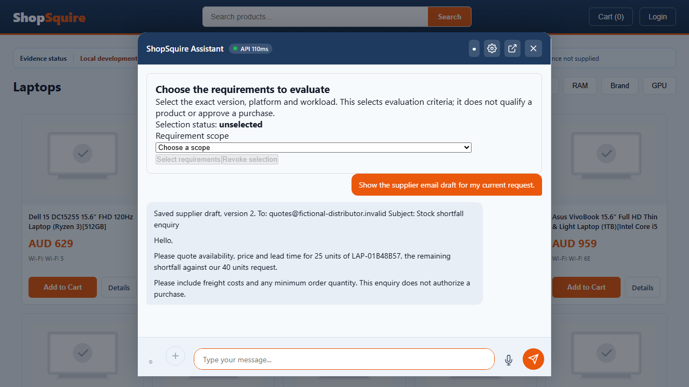

# ShopSquire: current capability, execution delta and remaining roadmap

25 October 2026. Assessment of `integration/pilot-savepoint-20261025`, [draft PR 31](https://github.com/lkjalop/ShopSquire/pull/31). This supersedes same-day **current-status** summaries; older reports remain dated evidence. It does not replace their raw results with newer, more favourable counts.

**A controlled pilot journey is demonstrated; the release is not green.** The selected pilot uses the existing [electronics text catalogue](2026-08-08%20laptop-products-aug.txt), synthetic stock and supplier contacts, real consented SearXNG discovery, exact shortfall arithmetic and a reviewed draft. It does not establish a real merchant's stock, supplier delivery commitments or technical workload compatibility.

The execution window began **19:03:42 Sydney AEDT / 18:03:42 AEST** and ends **22:03:42 Sydney AEDT / 21:03:42 AEST**: three hours, earlier than the user's alternative 22:00 AEST limit. Commercial sending, payments, merging and deployment stayed disabled.

## Candidate identities and recovery

The starting head was `32533793`. The first full/native verification freeze was **`56a91bdc11abcef198c088536d7055dec0812b43`**. **`f5b7ec62a8725802c62654e6cf3a276958febb0c`** subsequently formatted 26 compact Python files; all 26 before/after parsed ASTs were identical, and 100 focused tests passed. Later commits isolate nested test owners (`130695d2`, `d9ac7ebc`), persist strict privacy-fixture grants (`2751ccf2`) and repair ticket UUID redaction. The **final functional/test freeze is `5f84554c0e243cfb208460e3b6078cc3abc312d1`**, tested in another immutable worktree. Formatting equivalence is not a substitute for running required suites on that candidate.

All 339 original dirty paths had already been preserved and integrated in explicit cohorts. The current task added coherent repair/test commits and source savepoints. Source bundles were independently cloned and checked with `git fsck --full`. The formatting checkpoint bundle is `resumed-pilot-f5b7ec62.bundle`, SHA-256 `d0fdf3ebe9ade90a2b1538584482ca0f97f9a178eddbd6833873464f303b90e6`, under the user's private `C:\AI\ShopSquire-Savepoints\20261025-094031` directory. Private preservation refs, keys, runtime configurations and raw artifacts are excluded from public branch pushes. This is same-drive source recovery; off-device and whole-system recovery remain open.

## What changed during this execution

The earlier checkpoint already extracted neutral product-lane labels from `App.tsx` and replaced repeated pixel scans with a histogram in `_chi_square_lsb`. Those repairs remain in the candidate. The histogram benchmark is a deterministic channel-calculation/equivalence measurement; it does not establish detector accuracy or resolve the previously recorded 151.56-second security request. This execution adds the work below rather than recounting those earlier repairs as new commits.

| Area | Repair and evidence | Practical limit |
|---|---|---|
| Ordinary buyer workflow | Native registered buyer browses laptops, selects a SKU, explicitly accepts simulated stock, requests 40 units against 15 held and receives a draft for exactly 25 remaining units. Reload retains the draft hash and version. | Synthetic catalogue/stock/contact; no supplier dispatch. |
| Live research and email continuity | Real consented search dispatch is joined to the same buyer case. A material research revision requires fresh stock acceptance. Buyer preview and operator composition share the same draft hash; an independent reviewer approves, an edit creates version 2 and revokes approval. | Source discovery is not supplier confirmation. The tested lead-time question remains blocked when no current scoped evidence answers it. |
| Category-neutral bundles | An explicit laptop + monitor + bag whole-budget request returns tenant-admitted category lines with quantity, subtotal and same-currency total. Example listed total: **AUD 877.95**, not rounded component prices. | Bounded literal category grammar, 2–6 categories, quantities 1–500; no arbitrary workload fit, FX, tax/freight, compatibility or multi-line inventory reservation claim. |
| Money and layout | Listed 69.95 is preserved; AUD/USD/EUR formatting controls pass. Catalogue panel fits its dialog. | Regional tests use controlled prices. They do not prove real regional offers, landed costs or FX. Carousel still scrolls internally. |
| Inventory ownership | Scoped inventory reads and writes reject mismatched body/query tenants; an actual foreign-stock read was reproduced and repaired. Broad inventory controls: 54 pass. | Remaining operator surfaces require the same review; passing one router does not certify every API. |
| Rules ownership and cache | CRUD, preview and dry-run enforce tenant ownership; mutation predicates are atomic in the store. Cached rule entries are partitioned by runtime database owner and retired owners' data are evicted. | This local rule cache is separate from distributed semantic-cache erasure. |
| PostgreSQL audit | Audit columns resolve the actual relation on each connection, rather than combining schemas or caching by URL. A failed tenant-owned insert cannot fall back to an unscoped write. Final helper extraction retains existing size ceilings. | This repairs the tested audit boundary; it does not qualify scheduler/session endurance or every logging failure. |
| Temporal admission | Malformed explicit catalogue expiry is held instead of falling back to observed age. Combined controls: 51 pass. | Complete interval, timezone and source-revision coverage still needs evaluation. |
| Ticket audit identity | A deterministic UUID that the full run misclassified as a phone number now survives both privacy passes in the typed `ticket_id` field. Actual phone/email/SSN and appended PII rejection controls remain; 21 audit/PCI/redaction controls pass. | Exemption is restricted to the minted `TKT-UUIDv4` shape, not arbitrary identifiers or free text. |
| Indexed memory/API privacy | Dedicated real Redis checks cover exact scope, erased-value visibility across instances, partitions, replacement processes and retryable API deletion. API positives use persisted strict operator grants with wrong-role/foreign-controller rejection. | This does not prove erasure of all SQL business records, attachments, legacy embeddings or backups. |
| Browser fixtures | Explicit owned tenant grants replace accidental reliance on bypasses; trace tests no longer inherit build-time operator keys. | General hosted strict-mode fixtures remain incomplete. Authentication/setup failures do not prove intended positives. |
| Readability | 26 smaller files formatted with AST parity; changed-file lint falls **329 → 223 findings**. No size limit was raised. | Formatting expands physical lines; this is not a reduction in logical code or a completed structural refactor. |

Commit anchors: `ecab49da`, `e3620c62`, `c9b6322b`, `af3c4022`, `3d55fbb5`, `c77f8def`, `25431446`, `012f91f4`, `591c3ca9`, `2780275e`, `9f069b60`, `df146864`, `4c4f08a1`, `56a91bdc`, `f5b7ec62`.

## Final verification ledger

<!-- FINAL_LEDGER_START -->
Functional/test source: **`5f84554c`**. Results below retain their runtime, actor and fixture limits.

| Profile | Result | What it establishes / does not establish |
|---|---|---|
| Final full Python, Windows locked environment | **8,976 pass / 0 fail / 0 error / 309 skip**; 2390.2s | Complete selected suite with slow tests, offline models and test-mode membership auditing. The confirmed nested-async harness loophole remains; this is not hosted strict-mode or release green. |
| First complete Python freeze, `56a91bdc` | **8,966 pass / 6 fail / 1 error / 307 skip** | Original failures retained: ticket UUID redaction, five nested-child ownership failures and one owned-server startup error. Selected repairs and the final complete run are separate evidence. |
| Final storefront / admin | **470 / 63 pass**, zero failures/errors/skips | Both type checks and production builds pass on the final source. Unit assertions do not establish complete live journeys. |
| Complete offline browser sweep | **96 pass / 60 fail / 46 skip**, zero flaky; 90 spec files / 202 cases | Fresh strict-member shops, compiled UI, local cache fallback; declared mocked boundaries retained. Both disjoint shards' tracked-source fingerprints match before/after. |
| Dedicated original-image security | **13 pass**, zero failures/skips | Nine original attack uploads/trace checks, two clean API carriers, late callback and unavailable-inspection controls; models/OCR/external effects disabled. |
| Dedicated real-search/draft journey | **3 pass**, zero failures/skips | Actual non-fixture dispatch, retained case facts, exact 40/15/25 draft and shared review/version/reload; no completed cited lead-time answer or accepted FreeCAD claims. |
| Additional explicit live-source positive attempt | **1 fail** | Reviewed canonical-source fetch UI assertions are reached; buyer `governed-evidence-ladder` is missing. This is not hidden in the three passing journeys. |
| Dedicated real Redis, final source | **13 pass**, zero failures/skips | Scope/erase/partition/replacement-process controls and strict multi-instance API deletion/retry; all-plane deletion and approved export remain separate. |
| Unchanged cart clear/restore with real Redis | **1 pass**, zero failures/skips | Signed fixture buyer with merchant headers; distinguishes the offline fallback failure from the durable shared-backend positive. |
| Native PostgreSQL contract sweep | **78 pass / 1 skip**, zero failures/errors | Seventeen native contract files against a separate certificate DB with canonical public migrations; resource bounds retained. |
| Explicit PostgreSQL-only draft certificate | **1 pass** | The opt-in case skipped in the general sweep passes with its required PostgreSQL-only fixture boundary; no supplier dispatch. |
| Owned API restart + SQLite online-backup restore | **3 stages pass** | Same case facts survive actual process restart and restoration into another database file; no Redis or whole-system disaster-recovery claim. |
| Bounded three-spec browser replay | **17 successful cycles / 1,200 seconds** | Qualification, case selection and stock-display scenarios; resource limits retained. Not 60-minute, model/image/provider or whole-pilot endurance. |
| Fresh Python advisory queries | **217 locked / 184 full-installed / 127 clean-installed versions: no reported advisories or lookup errors** | Lock hash unchanged; marker-aware installed versions match. Does not establish container OS or zero unknown vulnerabilities. |
| Repository static checks | **3,235 Python parses; 419 JS/TS syntax checks; no reported undefined Python names** | Source census and configured syntax/lint checks, not semantic review or execution coverage of every line. |
| Lint / size ratchets | **224 PR findings; 1,680 all-tracked-Python findings**; existing size ratchets pass | No ceiling was raised. Passing ratchets preserve known debt: 49 large files and 96 large functions. |
| Hosted checks on `5f84554c` | **31 success / 14 failure** | Failing checks: 12 general strict-mode shards, procurement browser setup/battery and changed-file lint. PostgreSQL, service shards, clean install, integration, frontend and architecture checks pass. |

Recorded profile resource violations: **none** for the final full run. This is a measured bounded run, not proof of zero future hangs. Earlier setup refusals (missing browser before installation, occupied owned port, and a disposable-root admission refusal) remain in private receipts; retries used new owned profile names and did not bypass the guards. Both dedicated backend containers were removed after their tests; the shared SearXNG and unrelated PostgreSQL services were left running.

<!-- FINAL_LEDGER_END -->

The machine-readable [execution evidence](audits/timebox-execution-evidence-2026-10-25.json), [native browser case ledger](audits/timebox-browser-cases-2026-10-25.csv) and [source map](audits/timebox-source-map-2026-10-25.csv) preserve candidate identity and test scope. Counts from overlapping profiles must not be added into an overall pass percentage.

All seven earlier failure/error cases pass in the final complete Python run. Its five new redaction controls also run. Two previously passing full-platform browser cases now **skip with `frontend not reachable`**: `test_full_recommend_and_decision_trace_tabs` and `test_browser_recommend_to_cart_upsell`. Their earlier passes do not establish a currently owned frozen frontend. This explains the final 309 skips versus 307 previously; the separate owned 90-spec sweep remains the source-bound browser assessment.

The [named-case delta](audits/timebox-browser-delta-2026-10-25.csv) compares the earlier `a9778cf8` offline ledger with this freeze: 183 matched names, 19 added cases and five removed/renamed names. **Eight unexpected → expected** transitions cover ordinary category browsing, the bounded bundle and governed fictional qualification/offer journeys. **Nine expected → unexpected** transitions include cart restore, bulk-budget wording, trace/deep-link views, URL-intake receipt rendering and PDF intake. Different source, actors, setup and test versions prevent interpreting all nine as established application regressions. The failures still need resolution and remain in the ledger. Eleven passing terminal-helper controls explicitly mock boundaries; “native browser” does not make them eleven complete live-backend journeys.

The dedicated original-image profile uses the original on-disk bytes, not the resized images in chat: nine adversarial paths represent six unique attack-image hashes. The nine attack cases exercise upload and Decision Trace in the UI; two clean carrier controls use the authenticated API, with a separate late-callback race and unavailable deep-inspection control. A blocked/degraded unavailable scanner is not a successful attack classification. No embedded program, decoded instruction or beacon was executed. All 15 files in the original corpus/control baseline retain their hashes; the fixture generator was left untouched.

**Live-search success is narrowly scoped:** the final FreeCAD consent journey records an actual non-fixture external dispatch, but its research outcome is `discovery_status=degraded`, `fetch_status=not_attempted`, zero accepted claims and `publisher_not_yet_accepted`. This is consent/dispatch/retention evidence, not a completed requirements compilation or useful cited market answer. The shortfall draft succeeds because its catalogue/stock facts are separately accepted; the live research does not grant fit or commerce authority.

The native supplier-draft screenshot shows the saved version 2 asking for 25 units against a 40-unit request and explicitly declining purchase authority. Visual review also identifies unfinished polish: the unrelated requirement-scope selector occupies substantial space above an ordinary catalogue conversation, and product imagery is unavailable in this fixture. Those issues remain visible rather than being hidden by a successful assertion.



The offline browser runner deliberately uses unavailable Redis and local fallback. The cart-restore failure returns no durable undo snapshot in that profile. **The unchanged cart-clear/restore spec subsequently passed with a separately owned real Redis backend**, the clean API environment and compiled UI. Its actor is the signed fixture buyer with merchant headers; this is not the ordinary registered-buyer/no-key profile. Both outcomes remain in their respective ledgers. Several trace failures expect internal evidence views that the newer buyer/operator boundary withholds. Those need explicit actor/contract review, not restoring operator keys to ordinary buyers. Live-only, restart-stage and model/image-dependent specs also have setup requirements that the generic offline sweep does not satisfy.

## What TDD and “green” mean here

**New confirmed harness finding:** [the nested async wrapper](../tests/conftest.py) at `_safe_asyncio_run` (line 337 in the final freeze) waits 30 seconds, then can return `None` while its daemon worker remains alive. An owned probe reproduced exactly that at 30.0 seconds and then cooperatively stopped/joined its worker. The session leak check excludes daemon threads. This establishes a possible false-green/late-mutation path in the harness, not evidence that any particular previous application pass was false. It needs an explicit failed deadline and owned cancellation/process isolation with regression coverage; required suites must then be rerun. A rushed global async compatibility rewrite during frozen qualification would obscure which harness produced the results, so this finding is retained as a blocker.

A repair is behavioural green when the **unchanged acceptance expectation**, its useful positive and its rejection controls pass. Examples include the foreign inventory read, actual PostgreSQL schema-resolution failure, malformed expiry and missing ordinary stock-review action being reproduced before repair. Formatting has AST-equivalence and regression evidence; it is not presented as test-first feature development. Some browser matcher adjustments corrected the fixture's actual product name while retaining and strengthening authoritative SKU/category/quantity/price assertions; those are not evidence that every test remained textually unchanged.

Unit green proves only the selected isolated behaviour. Mocked integration establishes only its mocked boundary. Native browser green requires real UI interaction with the intended owned runtime and actor. A skip remains a skip; an unavailable provider remains unavailable; a 401/403 before a positive means its positive was not exercised. A correct refusal does not complete the buyer's requested task.

**Release green** additionally requires a reproducible clean installation, required broad suites and hosted strict-mode checks, security gates, database/Redis recovery and adequate endurance on one frozen candidate. The present mix of passing focused profiles and failing required broader profiles does not meet that definition. There is no defensible overall completion percentage.

The local full Python profile uses the locked Windows environment, offline models and test-mode membership auditing; dedicated strict-membership and real-backend profiles are reported separately. Hosted general shards use strict membership and file isolation. A local full pass cannot stand in for those failing hosted positives. No whole-repository execution line/branch coverage percentage was measured on the final candidate.

### Price direction and regional grounding

An unverified cart with no registered applicable policy remains **`review_required`**. Calling that state executed/pending would imply an effect or accepted workflow that has not been established. Preview calculations, reviewed offers, authorized actions and executed receipts should be separate fields/states, with a durable effect receipt required for execution.

| Approach | Decision |
|---|---|
| Treat any displayed catalogue price as an executable quote | Reject: stock, price basis, tax, expiry and approval can differ. |
| Calculate useful provisional totals, then review the exact current offer | Use for the pilot: show currency, unit/whole-order basis, quantities and missing landed terms explicitly. |
| Infer FX, GST/VAT, freight or supplier lead time from geography | Reject: obtain dated applicable terms or label them unknown. |
| Compare AUD/USD/EUR controlled cases | Use to verify arithmetic, cents, budget scope and rejection behaviour; not evidence of live regional price availability. |

For Australian, US and European cases, preserve the buyer's explicit currency and unit basis. Do not silently convert a total cap into a per-unit cap, or substitute a promotional/approved offer for the candidate's listed price. A real regional pilot additionally needs supplier terms for the actual delivery country, tax treatment, packs/MOQ, freight and offer expiry. This retains usefulness without fabricating commercial certainty.

## Review coverage and structural debt

The final functional source census hashes **5,997 tracked files**, including 5,954 text files and 1,202,978 text lines. All **3,235 Python files parse**; the 419-file JS/TS syntax scan reports zero diagnostics, and those sources are unchanged between the first and final freezes. Maintained application/frontend source comprises 1,546 files and 367,931 physical lines. This is a repository-wide inventory and static assessment, **not manual semantic review of every line, execution of every branch or proof of zero hangs**.

There are **49 maintained files over 1,000 lines**, **96 Python functions over 200 lines**, and **2,307 bare-pass exception handlers** across scanned Python. Exception handlers are review candidates, not 2,307 established defects. High-value boundaries to extract next:

| Owner at `56a91bdc` | Physical size | Why it matters / next boundary |
|---|---:|---|
| `routers/chat.py`, `_chat_query_impl` | 4,826 file / 4,470 function lines | Separate orchestration from case transition, research delivery and draft projection; retain a single canonical revision contract. |
| `frontend/src/components/DecisionTrace.tsx` | 4,339 | Extract revision-bound buyer explanation and privileged operator evidence views with actor tests. |
| `frontend/src/App.tsx` | 4,104 | Extract case/controller ownership and catalogue/bundle presentation; keep async cancellation and late-response tests. |
| `routers/admin.py` | 4,106; 118 current lint findings | Split coherent operator domains with shared admission; do not merely move tangled dependencies. |
| `services/support_complaints.py` | 4,025 | Separate intake, identity, evidence and resolution state. |
| `services/orchestrator.py` | 3,888 | Review swallowed failures and lifecycle ownership before adding agents. |
| `routers/merchant_dashboard.py` | 3,188; largest function 2,328 | Split data queries, validation and response composition; require tenant-positive/rejection controls. |
| `main.py`, `create_app` | 2,409 / 2,200 | Separate lifespan-owned workers, resources and admission configuration; test shutdown/restart and DB contention. |
| `recommendation_core/core.py`, `_recommend_turn` | 2,778 / 1,282 | Continue bounded stage extraction without adding a parallel reasoning framework. |

The retired legacy storefront's roughly 4,000-line `App.jsx` is a maintenance/retirement decision, not proof that the active React storefront executes it. The final changed-file Ruff scan has **224 findings across 231 changed Python files**; the larger accumulated comparison has 841 findings across 1,510 files. Both report zero undefined-name findings. Formatting reduced the earlier changed scope from 329 to 223 findings; five subsequently changed files expand the final PR scope and expose one pre-existing unused `typing.Generator` import in `deps.py`. Historical audit snapshots were not reformatted to rewrite their evidence.

A separate **all-tracked-Python Ruff scan covers all 3,235 files**: 1,680 reported findings, including 542 unused-import findings, 297 multiple-statement findings and 263 import-placement findings; no undefined names are reported under the configured rules. These are broader than the PR gate and remain static review candidates. Fixture re-exports and import side effects need review before cleanup; blanket automatic deletion would be unsafe.

## Reordered remaining W00–W15 roadmap

Order follows dependencies and current failure evidence, not a claimed percentage. Each package must finish with named positive and rejection evidence.

| Order / package | Remaining work and reason | Exit evidence |
|---|---|---|
| 1 · W00 reproducible integration | Source is preserved and pushed to a draft branch. Add off-device backup, documented clean pilot installation and runtime/config inventory. | Independent source restore plus clean installation and private runtime recovery instructions. |
| 2 · W12 identity/operator boundaries | Repair explicit owned fixture grants across general strict-mode suites; assess remaining operator routers, global analytics and legacy tenant-less records. Preserve production enforcement. | Useful authorized positives, wrong-tenant/role rejection and atomic mutation controls on SQLite and PostgreSQL; required hosted jobs pass. |
| 3 · W01 database/session/scheduler | Replace the confirmed silent nested-async timeout with a failed owned deadline/cancellation contract. Nested fixture collisions and ticket audit IDs were repaired; retain startup-error repro/recheck evidence. Exercise SQLite contention and PostgreSQL rollback/shutdown. | Timeout cannot report success or mutate later; useful/timeout/rejection controls, no orphan workers, bounded contention/restart evidence, required rerun under the repaired harness. |
| 4 · W02 dependencies/installation | Fresh Python advisory snapshots are clear and installed versions match applicable lock entries. Keep full/clean/hosted profiles explicit: the flat clean profile includes pinned `async-timeout` compatibility support even on newer 3.11 patch releases. Complete container OS remediation and provider-specific clean installations. | Marker-aware locked clean installs, required audits with no unexplained exclusions, current image scan and runtime smoke. |
| 5 · W11 useful shopping/bundles | Repair failing gaming, deadline/ambiguity and open-world browser journeys. Extend literal bundle parsing to amendments, multiple lines and fit-sensitive requests without inventing compatibility. | Useful eligible candidates plus rejection controls; quantities/budget survive amendments/reload; unavailable fit remains labelled. |
| 6 · W03 evidence intake | Finish same-case source binding across uploads, delayed callbacks and older support paths; show a useful clean-upload positive. | Original attack/clean controls, stale revision rejection and exact source-to-case provenance. |
| 7 · W04 case transitions | Cover refinement versus replacement, simultaneous cases and changed bundle quantities/currency/destination. | Named permutation matrix retains intended facts and invalidates affected evidence/approvals. |
| 8 · W08 inventory/fulfilment | Replace fixture stock with a merchant-owned adapter; specify SKU, UoM/pack quantities, stock freshness, hold expiry, concurrency and recovery. | Read-only real catalogue validation first, then exact permitted holds and recovery; no invented stock. |
| 9 · W09 grounded commercial terms | Establish price basis, MOQ, freight/tax, offer expiry and regional delivery terms. Keep unverified carts/policies in `review_required`. | AUD/USD/EUR controlled arithmetic plus separately sourced regional offers; exact current reviewed artifact authorizes any effect. |
| 10 · W06 market intelligence | Obtain current evidence for the requested facet, product, region and time. Demand signals must not establish supplier lead time. | At least one useful live cited answer with claim-level entailment and expiry; stale/irrelevant sources correctly withheld. |
| 11 · W05 supplier communications | Shared preview/review/edit versions now work. Add multiple supplier selection, units/packs, buyer tone/disclosure preferences and explicit missing terms. | Exact quantity and supplier binding, reviewed version/hash, material-edit approval revocation, reload; draft-only by default. |
| 12 · W07 memory/privacy | Indexed Redis and strict multi-instance API erasure/retry now have bounded positive evidence. Complete coverage across SQL business records, attachments, embeddings, derived query clusters and backups. | Cross-instance write/index failure, erase/read race and restart/restore controls across every declared plane; no resurrected erased facts. |
| 13 · W10 cancellation/deadlines | Trace client cancellation through server work and worker ownership; classify slow and unknown outcomes. A browser abort alone does not cancel backend work. | Bounded concurrent requests, no late state mutation, no orphan tasks, idempotent retries and accurate unknown-ack status. |
| 14 · W13 structural debt | Extract the owners above in small dependency-complete commits; review silent failures and retire stale paths only after caller/config verification. | Unchanged behavioural controls, import/type/syntax and size ratchets, smaller coherent owners; no blanket waivers. |
| 15 · W14 evaluation/portability | Add held-out non-electronics, regional, mixed-unit and long-horizon buyer scenarios; measure useful task completion, retrieval precision and latency. | Product-type adapters rather than electronics-specific defaults; disclosed profile/sample limitations. |
| 16 · W15 release/recovery/endurance | Freeze a final candidate after repairs; rerun complete required Linux/Windows/Redis/PostgreSQL/security/native profiles, backup restore and longer endurance. | One source identity and installation manifest for all required gates; failures/skips and provider coverage explicit. |

### One-day and five-day pilot options

**One day:** hand over a controlled, operator-supervised demonstration using the mock catalogue, read-only real search and draft-only email. Include a clean start/stop script, exact fixture identity, demonstrated 40/15/25 journey, known-failure ledger and rollback/source bundle. Required setup and core journey must pass on the recipient's machine. Do not label it merchant-ready while required checks fail.

**Five days:** first address strict CI/setup and database ownership, then repeat useful shopping permutations and establish one positively useful cited market answer. Add a read-only merchant catalogue adapter if real data become available; retain simulated stock until inventory authority is explicitly validated. Freeze for security/recovery/endurance with a documented operator runbook. This is a planning target, not a guarantee or grounds to compress failing gates into “green”.

### Reproduce the controlled demonstration

Use Python 3.11 and Node 22 from a clean checkout. The [README installation steps](../README.md) distinguish Windows/Linux scoped requirements from the broader development environment. Install the committed storefront lock and its Chromium browser; do not substitute an unpinned global Playwright installation. Example Windows setup:

```powershell
python -m venv .venv
.\.venv\Scripts\python.exe -m pip install -r requirements/bootstrap-runtime-windows.txt
.\.venv\Scripts\python.exe -m pip install -r requirements/api-runtime-windows.txt -r requirements/test-runtime-windows.txt
Push-Location frontend
npm ci
npx playwright install chromium
Pop-Location
```

Prepare new disposable directories for each replay. For live discovery, the explicitly selected local SearXNG service must already be reachable at loopback port 8888; preparation does not start or alter it.

```powershell
$pilotReview = '.artifacts/pilot-review-' + [guid]::NewGuid().ToString('N')
$pilotLiveReview = $pilotReview + '-live'
.\.venv\Scripts\python.exe -m scripts.prepare_roadmap_demo --directory $pilotReview
.\.venv\Scripts\python.exe -m scripts.prepare_live_research_demo --source $pilotReview --directory $pilotLiveReview
.\.venv\Scripts\python.exe -m scripts.run_roadmap_browser --directory $pilotLiveReview --live-research --frontend-mode preview catalogue-shortfall-draft.spec.ts consented-live-research.spec.ts live-research-memory-assessment.spec.ts
```

This is an automated browser demonstration, not a published merchant service. It starts owned local API/UI processes, refuses occupied ports, retains reports and closes its processes on completion. Runtime credentials stay in ignored private fixture configuration; ordinary storefront requests do not borrow operator keys. The selected journey makes no supplier send or payment. Missing SearXNG, blocked sources, unsupported lead-time evidence and failed assertions retain their actual outcomes. On a recipient machine these commands still require a fresh successful run before handoff readiness can be claimed.

## Buyer permutations to qualify

Product independence should extend the existing contracts: merchant/SKU/variant identity; category attributes; count/UoM/pack size; currency and price basis; stock location/freshness; delivery region; dated facet-specific evidence; and the same versioned draft/review artifact. Use catalogue/domain adapters and configured taxonomy, rather than copying the chat pipeline or adding another memory/agent framework. Furniture dimensions, clothing variants and consumable packs need held-out fixtures and their own useful/rejection journeys. Neutral labels and three additional electronics categories are progress, not proof of a product-agnostic platform. An accessory offer needs evidenced compatibility or an explicit “unassessed” boundary, and buyer acceptance before any cart mutation.

| Input/permutation | Current evidence / remaining acceptance |
|---|---|
| “30, actually 40 units” | Dedicated native correction/reload and 40/15/25 draft demonstrated. |
| “AUD 1,500 each” versus “AUD 3,000 total” | Scope retained; whole-budget bundle math demonstrated. Broader bulk-budget/browser disagreements remain. |
| Change to USD/EUR | Controlled money/budget tests; real regional offer/delivery qualification remains. |
| Change destination or date | Retention controls exist; recalculate shipping, deadlines and affected approvals. |
| “Laptop, monitor and bag” | Explicit category bundle demonstrated; compatibility and simultaneous reservations unassessed. |
| “Add two monitors; keep the laptop” | Requires bundle amendment/retention qualification. |
| “Can you upsell within the same total?” | Governed fictional-offer controls exist; general ordinary-chat upsell must prove usefulness and consent. |
| “For gaming/Blender/PLC refinement” | Broad cases still fail or withhold candidates; preserve workload and prove fit before recommending. |
| Ambiguous arrival/quantity/price basis | Ask a focused clarification and retain the answer; failing native cases remain open. |
| Accept/decline external search | Consent-bound dispatch demonstrated separately; declining consent must cause no outbound call. |
| “What is demand?” versus “When can the supplier deliver?” | Facet distinction enforced; live lead-time result is currently unknown, not completed analysis. |
| Stale, malformed or future validity | Focused temporal rejection controls; extend to regional/timezone intervals and changing sources. |
| “Draft, do not send” | Exact shortfall draft, explicit no purchase authority and disabled dispatch demonstrated. |
| “Remove my budget from the email” | Operator disclosure edit creates version 2 and revokes approval; free-form buyer disclosure amendments need broader qualification. |
| “Use supplier B / split the order / packs of 12” | Supplier, SKU, UoM and review binding remain required; do not silently reinterpret units. |
| Reload / API restart / restore | Case-fact reload and dedicated owned restart/SQLite restore profiles; whole draft/outbox/distributed recovery still separate. |
| “Forget this” on another instance | Complete distributed erasure/recovery is a release blocker. |
| Different tenant, person or stale approval | Inventory/rules/draft focused rejection controls; remaining APIs still need systematic scope review. |
| QR, hidden image instruction, late callback | Dedicated original-byte security controls pass; useful clean-image/model-provider qualification remains distinct. |
| Timeout, retry, cancel or unknown send acknowledgement | No inference of delivery from a request; server cancellation and provider reconciliation remain to qualify. |
| Product returns, external purchase or non-electronics | Requires explicit domain adapters and held-out native journeys; no blanket product-agnostic claim. |

## Research direction: memory, temporal/spatial RAG and intelligence

The primary-paper abstracts for [Threader](https://arxiv.org/abs/2609.33226), [Mem++](https://arxiv.org/abs/2610.02002), [IA-RAG](https://arxiv.org/abs/2606.06044) and [S3Mem](https://arxiv.org/abs/2605.28831) motivate preserving dated source history, retrieving evidence at question time and reasoning explicitly about validity intervals. [Spatial-RAG](https://arxiv.org/abs/2502.18470) combines spatial and semantic retrieval; [Bridge](https://arxiv.org/abs/2605.19172) addresses region/time-aware delivery-demand prediction. Neither directly proves supplier lead time for a buyer's SKU.

A further primary-source search on 25 October checked [APEX-MEM](https://arxiv.org/abs/2604.14362), which describes append-only temporal event graphs and retrieval-time conflict resolution, and [MOSAIC](https://arxiv.org/abs/2607.16211), which describes typed graph storage and save-time conflict checking. Those are alternative design emphases to evaluate against raw-history/read-time approaches, not reasons to install both. Reported benchmark gains were not reproduced here. “Non-destructive” history must still obey the platform's retention and erasure contract; it cannot justify resurrecting a buyer's erased facts.

**Engineering inference for this repository:** strengthen existing revisioned case state, source provenance, tenant boundaries, validity intervals and region/facet filters before installing another memory framework. Add spatial indexing only when warehouse distance or delivery coverage changes a real decision. Evaluate held-out queries, temporal contradictions, retrieval relevance and erasure before adopting architectural novelty. These are abstract-level research checks, not paper replications or a complete literature review.

[SearXNG's search API](https://docs.searxng.org/dev/search_api.html) supplies discovery results; authoritative stock and supplier commitments require separate owned evidence. The communication layer should present exact known quantities and ask for missing lead time, MOQ, freight and price rather than manufacture those terms.
