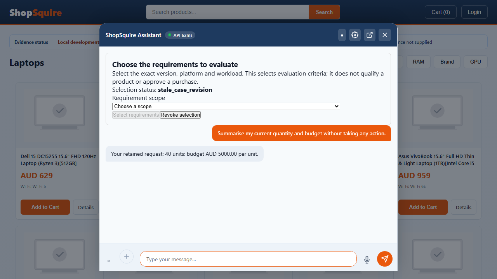
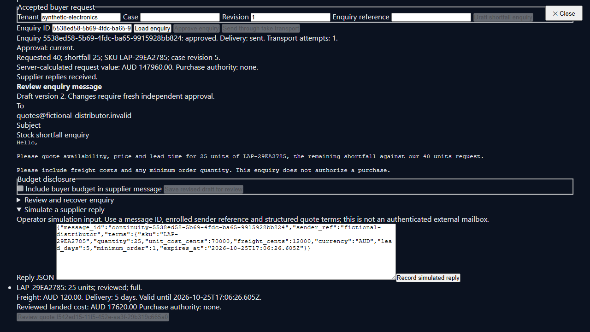

# Browser evidence and visual assessment

These are unmodified screenshots from the passing C22 real-API `reviewed-supplier-draft-continuity.spec.ts` case. Source commit: `cf617339b55a7b432535831f5dd29d29dfff9977`. Inventory, scope, supplier address and quote are fictional; dispatch uses sandbox transport. The screenshots demonstrate this scenario, not general product readiness or an accessibility audit. Original traces and videos remain private.

## Retained buyer facts after reload

The response retains **40 units and AUD 5,000 per unit**. The test also checks the same case ID and no commerce authority. The screenshot shows a remaining UX issue: internal state text `stale_case_revision` appears without a plain-language explanation or a clear recovery instruction. A requirement-selection panel occupies substantial space even during a summary turn. Product images are placeholders in this fixture. The displayed API timing is one UI observation, not a latency benchmark.

## Exact reviewed shortage draft

The reviewed version requests a quote for **25 units against the original 40-unit request** and omits the buyer budget. The passing browser assertions compare the buyer preview and operator message/artifact, invalidate old approval after editing, reject stale dispatch, and require independent approval again. A reviewed simulated supplier reply then answers a lead-time question with a cited five-day observation, explicitly labelled simulation; reload preserves the buyer request.

The operator panel remains a lab-oriented UI: dense form rows, raw JSON reply entry and little visual hierarchy. Simulated reply entry must stay confined to an explicit operator/demo context; a deployed mailbox needs authenticated provider ingestion. The displayed quote total contains the recorded unit cost and freight; this screenshot does not establish a complete destination-tax/duty/FX landed total. Responsive layouts, keyboard traversal, focus restoration, screen-reader labels and realistic content-length handling need their own checks.

The [case ledger](2026-10-25-browser-c5-c23-case-delta.csv), [execution receipt](2026-10-25-execution-evidence.json) and [remaining roadmap](../EXECUTION_DELTA_AND_MVP_ROADMAP_2026-10-25.md) retain the broader failing and skipped results. A selected passing screenshot must not replace those results.
